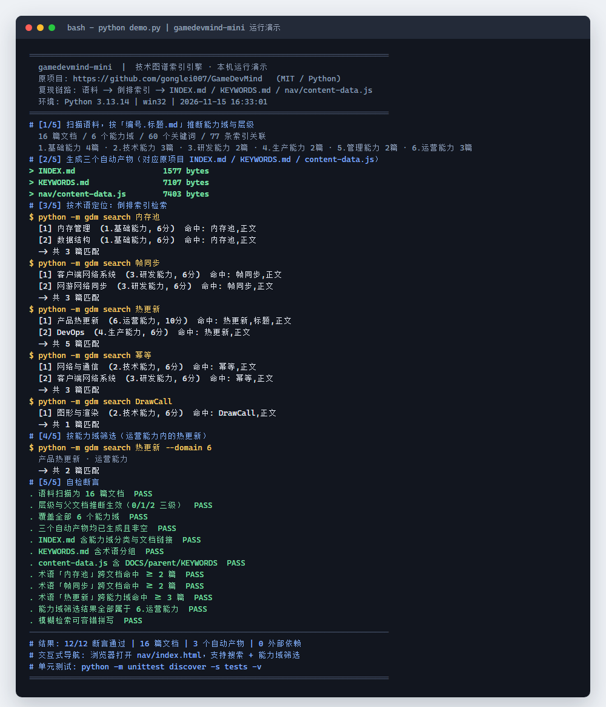
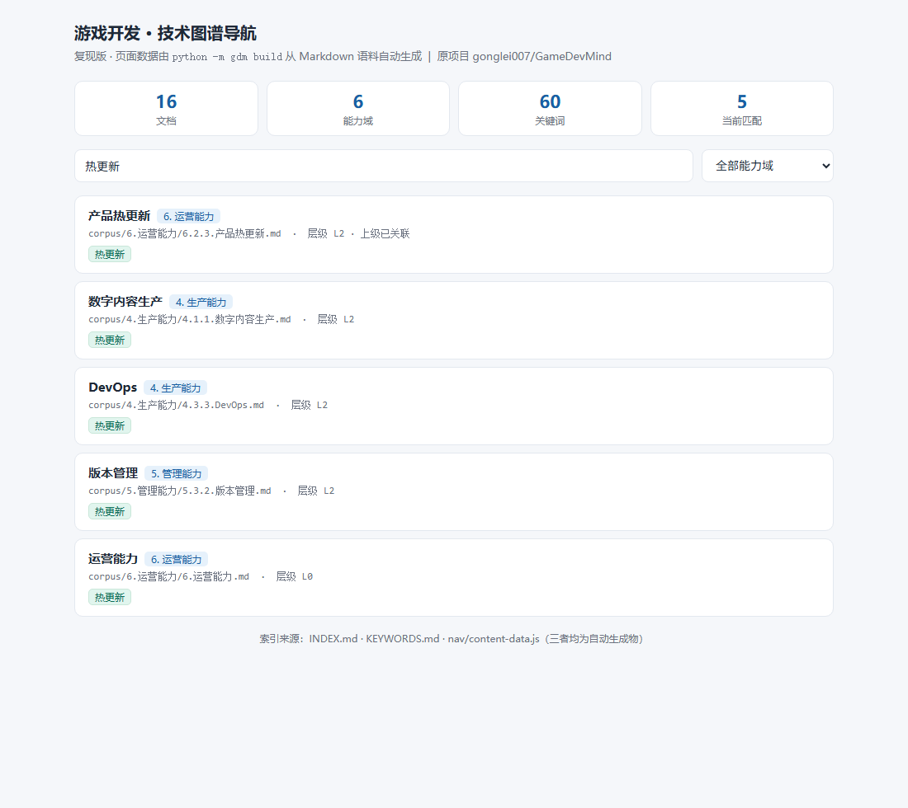

# gamedevmind-mini

> 对 [gonglei007/GameDevMind](https://github.com/gonglei007/GameDevMind) **「索引自动生成 → 术语检索 → 交互式导航」**核心链路的零依赖 Python 复现。
> 按部长第一次任务提出的 5 步要求，换一个开源项目完整做一遍。

**一句话**：这个项目不是拿来 `npm start` 的软件，而是一套「把 124 篇文档组织成可检索知识图谱」的系统；最值得复现的是它的**索引生成机制**。

```text
corpus/ 里 16 篇 Markdown
      ↓  按「编号.标题.md」推断能力域 / 层级 / 父文档
      ↓  读取 front-matter 关键词，构建倒排索引
      ↓  自动生成
   INDEX.md          按能力域浏览
   KEYWORDS.md       按术语定位
   nav/content-data.js  交互式导航的数据源（DOCS + KEYWORDS）
      ↓
   python -m gdm search 热更新     按术语检索
   python -m gdm search 热更新 --domain 6   按能力域筛选
   nav/index.html     浏览器里搜索与筛选
```

---

## 一、原项目是什么

> 数据于 **2026-11-15** 通过 GitHub API 与仓库 README 原文获取，与用户截图一致。

| 项目 | 内容 |
| --- | --- |
| 仓库地址 | https://github.com/gonglei007/GameDevMind |
| 名称 | 游戏开发 · 技术图谱（Game Development Map） |
| Star / Fork / Watching | 6,689 / 661 / 69 |
| 提交 / 分支 / 标签 | 1,134 Commits · 6 Branches · 7 Tags（截图） |
| 语言 / 许可证 | Python（主要语言） / MIT License |
| 创建时间 / 默认分支 | 2022-06-22 / main |
| 规模 | README 自述 124 篇文档、2 类代码示例、8 个案例与诊断练习、5 个 AI 协作记录 |

### 解决什么问题

仓库 About 原文：*「最全面的游戏开发技术图谱。帮助游戏开发者们在已知问题上节省时间，省出更多的精力投入到更有创造性的工作中去。」*

游戏研发的知识极度分散：渲染、网络同步、资源管线、热更新、支付幂等……同一个坑常被不同项目反复踩。README 自述面向「游戏程序员和技术负责人」，把这些经验做成**系统化知识库**，让已知问题可查、可复核，而不是每次靠人重新摸索。

### 主要功能

- **六大核心能力域**：1 基础能力、2 技术能力、3 研发能力、4 生产能力、5 管理能力、6 运营能力；
- **四条使用路径**（README「从这里开始」）：系统学习（三条阅读路径）／查找具体问题（文档索引、关键词索引、交互式导航）／动手验证方案（代码示例、案例与诊断练习）／用 AI 推进研发（AI 资料中心）；
- **可立即使用的资源**：内存池、四叉树、客户端网络生命周期、帧同步 vs 状态同步等可运行代码；SLG 循环引用、MOBA 角色回弹、开放世界卡顿等 8 个诊断练习；
- **交互式知识全景**：`nav/` 下的导航页与 `panorama.html`，部署在 GitHub Pages。

### 核心机制（这次真正读到的一层）

翻索引文件头部的注释才发现，这个仓库里**最有工程含量的东西是自动生成出来的**：

| 产物 | 由谁生成 | 作用 |
| --- | --- | --- |
| `INDEX.md` | `tools/check/generate_catalog.py` | 按能力域/层级列出全部文档链接 |
| `KEYWORDS.md` | `tools/check/generate_keywords.py` | 术语 → 相关文档的倒排索引 |
| `nav/content-data.js` | `tools/check/generate_catalog.py` | 导航页数据，字段 `t`(标题) `p`(路径) `c`(能力域) `l`(层级) `r`(角色) `parent`(父文档) |
| README 的「124 篇文档…」 | 同一套工具链（`BEGIN GENERATED:content-stats` 标记） | 内容统计自动刷新 |

也就是说：**语料（mds/）是输入，索引与导航是输出，工具链把两者解耦**。加一篇文档不用手改四处索引。这正是本项目选择复现的核心功能。

---

## 二、本复现版做了什么

用 **Python 标准库、零第三方依赖**复刻上面这条链路：

1. `gdm/corpus.py`：扫描 Markdown，按 `1.1.6.内存管理.md` 这类编号推断能力域 `c`、层级 `l` 与父文档 `parent`，解析 front-matter 的关键词/角色/摘要；
2. `gdm/indexer.py`：构建倒排索引，自动生成 `INDEX.md`、`KEYWORDS.md`、`nav/content-data.js`（字段与原项目同款，另附 `KEYWORDS` 供网页检索）；
3. `gdm/search.py`：术语检索 + 能力域筛选 + 打分排序 + `difflib` 模糊容错；
4. `gdm/cli.py`：`build` / `stats` / `search` 三个子命令，`--corpus` 可指向任意 Markdown 目录（包括原项目 `mds/`）；
5. `nav/index.html`：纯静态交互式导航，支持搜索框与能力域下拉筛选，数据来自生成物；
6. `demo.py`：一键跑通全链路并做自检；`tests/test_gdm.py`：19 条单元测试。

**示例语料**：`corpus/` 下 16 篇自写短文，沿用原项目的编号与六大能力域命名（如 `1.1.6.内存管理.md`、`3.2.2.网游网络同步.md`），内容独立编写，只借结构不抄正文。刻意让术语跨文档交叉命中（如「热更新」同时出现在生产能力、管理能力、运营能力），用来验证倒排索引的价值。

### 诚实的边界（没做什么）

- 没有搬运原项目 124 篇文档、图片、XMind、PDF 导出工具、AI 协作资料；仓库约 1.8 GB，全量克隆不现实也没必要；
- 没有实现 `tools/merge`、`tools/pdf`、`tools/xmind`、`tools/smart` 等工具链，也没复现 C++/Go 代码示例与 `panorama.html` 知识全景；
- 语料是教学级小样本（16 篇 / 60 个关键词），检索打分是简化模型，不是原项目的完整实现；
- 交互式导航是本地静态页，未部署 GitHub Pages。

---

## 三、目录结构

```text
gamedevmind-mini/
├── README.md                 # 本文件
├── CONCEPTS.md               # GitHub 概念速查 + 注册步骤 + 读 README 的方法
├── REPORT.md                 # 可直接发群的作业讲解文案
├── PUSH.md                   # 可选：把复现版推到自己 GitHub 的步骤
├── demo.py                   # 一键运行演示（输出写入 run.log）
├── run.log                   # demo.py 的真实 stdout
├── INDEX.md                  # 生成物：按能力域浏览
├── KEYWORDS.md               # 生成物：术语 → 文档倒排索引
├── nav/
│   ├── index.html            # 交互式导航（浏览器打开即可）
│   └── content-data.js       # 生成物：DOCS / DOMAIN_NAMES / KEYWORDS
├── corpus/                   # 16 篇示例语料，按 1~6 能力域分目录
├── gdm/                      # 复现引擎：corpus / indexer / search / cli
├── tests/test_gdm.py         # 19 条单元测试
├── tools/
│   ├── make_screenshot.py    # 真实输出 → 两张运行截图
│   └── publish.sh            # 可选：一键推送
├── screenshots/
│   ├── run-demo.png          # 终端运行截图
│   ├── nav-demo.png          # 交互式导航截图（搜索「热更新」）
│   └── terminal.html         # 终端截图的渲染页
├── .gitignore
└── LICENSE
```

---

## 四、快速开始

环境：**Python 3.9+**，无需安装任何包。

```bash
# 1) 一键跑通全链路（扫描 → 生成 → 检索 → 自检）
python demo.py

# 2) 单元测试
python -m unittest discover -s tests -v

# 3) 单独生成 / 查看统计 / 检索
python -m gdm build
python -m gdm stats
python -m gdm search 热更新
python -m gdm search 热更新 --domain 6
python -m gdm search 帧同步 --corpus "C:/path/to/GameDevMind/mds"

# 4) 交互式导航（浏览器打开，或起个本地服务）
#    直接双击 nav/index.html 即可；搜索框输入术语，右侧可按能力域筛选

# 5) 重新生成两张截图（需本机 Edge / Chrome）
python tools/make_screenshot.py
```

### 运行结果（本机实测，2026-11-15）

```text
16 篇文档 / 6 个能力域 / 60 个关键词 / 77 条索引关联
INDEX.md 1,577 B · KEYWORDS.md 7,107 B · nav/content-data.js 7,403 B
demo.py: 12/12 断言通过      unittest: 19/19 通过
Python 3.13.14 | win32 | 0 外部依赖
```





> 截图说明：`run-demo.png` 每一行都来自 `demo.py` 的真实 stdout（见 `run.log`），渲染成终端窗口后截图；
> `nav-demo.png` 是本机浏览器真实打开 `nav/index.html?q=热更新` 的页面截图，数据取自自动生成的
> `content-data.js`。两者都不是手写示意，也避免截桌面带入无关隐私内容。

---

## 五、这次额外学到的概念

见 [CONCEPTS.md](CONCEPTS.md)：除了 Repository / README / Star / Fork，这次还用到了
**倒排索引、自动生成物、GitHub Pages、CI、front-matter** 等概念。

## 六、参考与致谢

- 原项目：https://github.com/gonglei007/GameDevMind （MIT License）
- 机制依据：其 `INDEX.md`、`KEYWORDS.md`、`nav/content-data.js`、`tools/README.md` 与 README 原文；
- 数据与截图中的仓库信息抓自 GitHub REST API，日期 2026-11-15；
- 本项目代码与示例语料为独立编写的教学复现，仅沿用原项目的命名与结构约定。
